# CRM Task Manager API

A production-ready Enterprise CRM & Task Management REST API built with NestJS, TypeORM, MySQL, and Docker. Features robust JWT-based authentication, Role-Based Access Control (RBAC), multi-tenant relationship mapping, dynamic query filtering, interactive Swagger documentation, and complete containerization.

---

## 🛠 Tech Stack

- **Runtime & Framework:** Node.js, NestJS (TypeScript)
- **Database & ORM:** MySQL 8.0, TypeORM
- **Authentication:** JWT (JSON Web Tokens), Passport.js, Bcrypt
- **API Documentation:** OpenAPI 3.0 / Swagger UI
- **Testing:** Jest, ts-jest
- **DevOps & Containerization:** Docker, Docker Compose

---

## 📂 Project Architecture & Modules

```text
src/
├── common/             # Enums, custom decorators, and global guards (Roles, JWT)
├── config/             # TypeORM and database connection configurations
├── modules/
│   ├── auth/           # Registration, login, password hashing, and token issuance
│   ├── users/          # User management, role scoping (ADMIN vs USER)
│   ├── customers/      # CRM client entities and customer tracking
│   └── tasks/          # Task management with multi-filtering and RBAC scoping
└── main.ts             # Application bootstrapping, global validation pipes, Swagger

## 📸 Deliverables & Proof of Execution

| Requirement / Metric | Screenshot |
| :--- | :--- |
| **01. User Registration** | 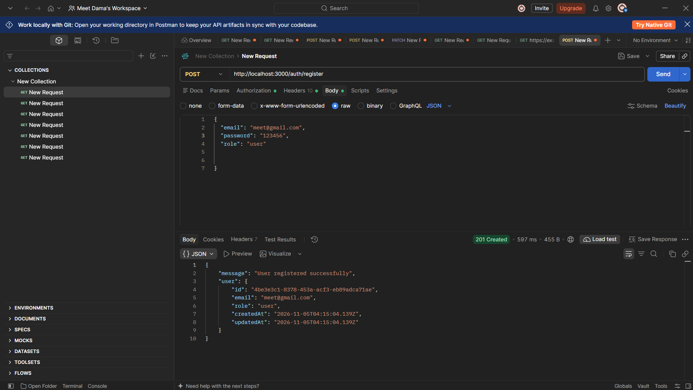 |
| **02. JWT Authentication** | 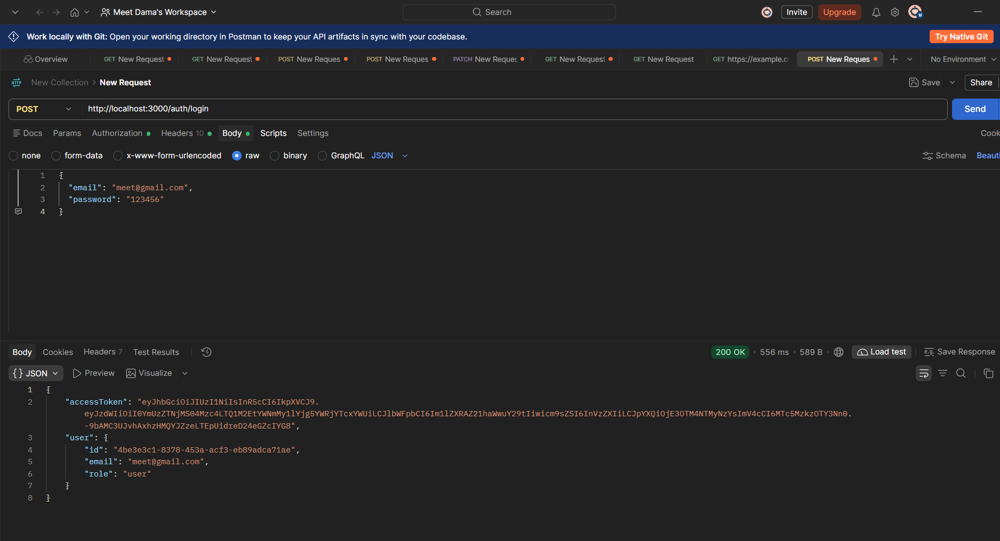 |
| **03. Profile Verification** | 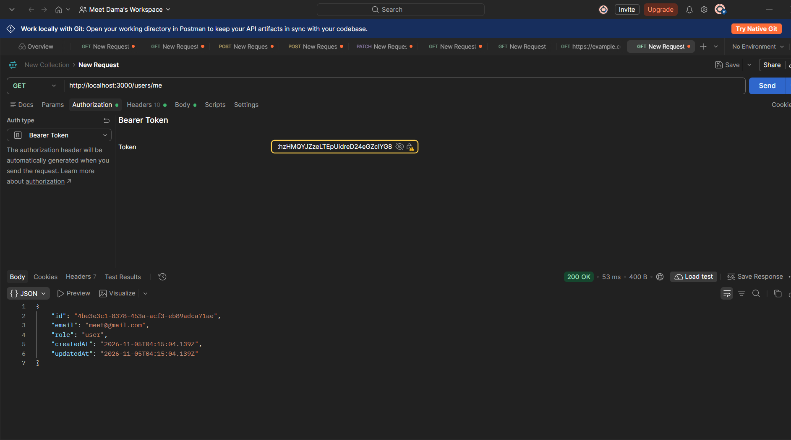 |
| **04. Unauthorized Access Check** | 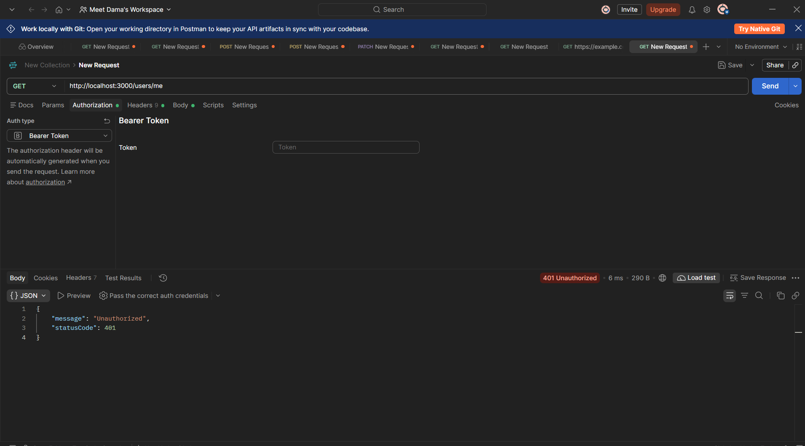 |
| **05. RBAC Admin Verification** | 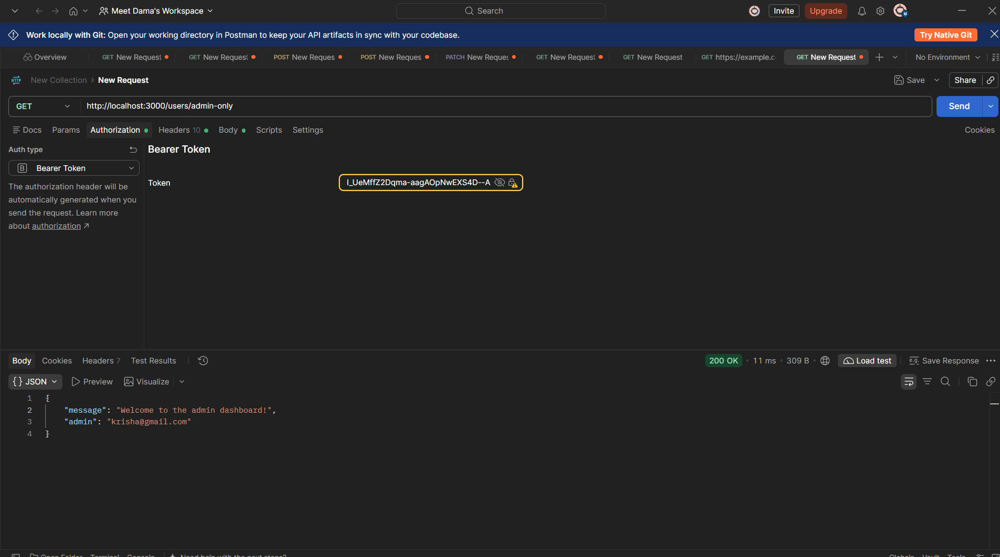 |
| **06. Task Creation (Relational)** | 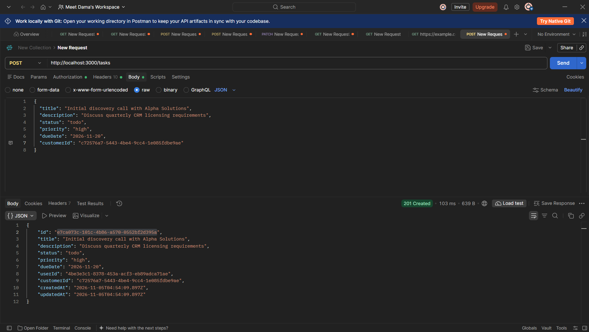 |
| **07. Task Relational View** | 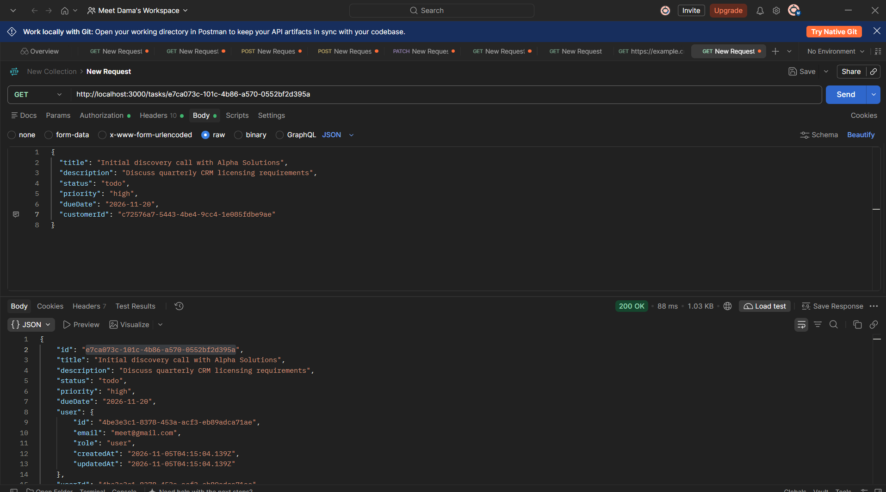 |
| **08. Dynamic Query Filters** | 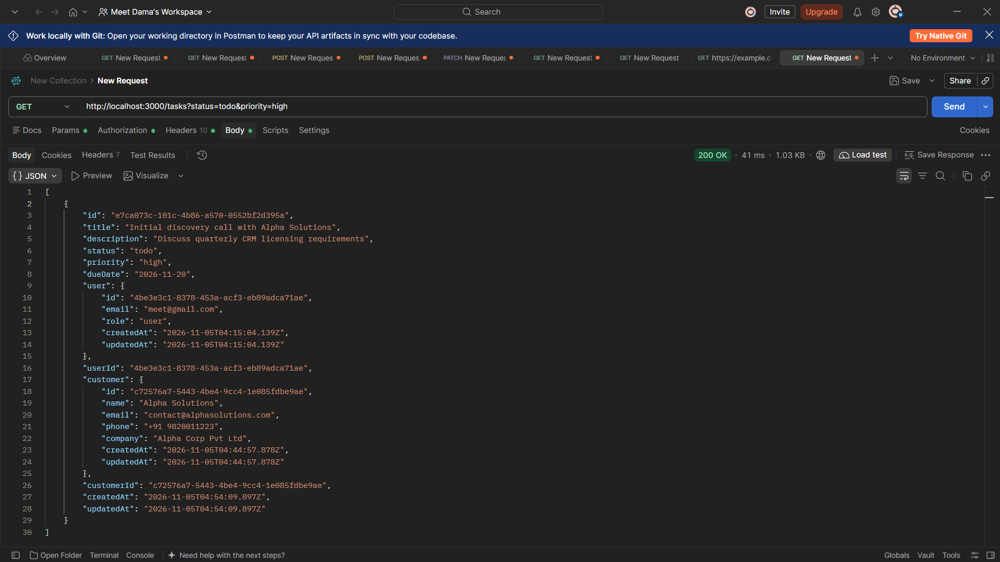 |
| **09a. Task Scoping (User View)** | 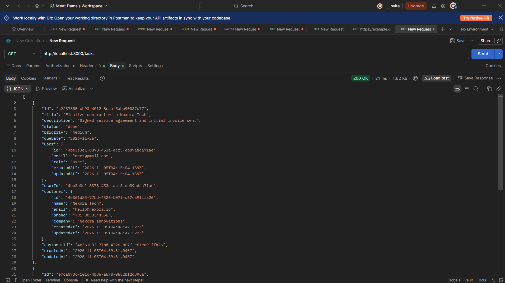 |
| **09b. Task Scoping (Admin View)** | 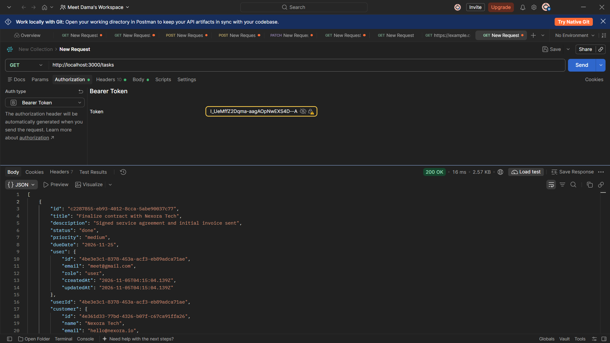 |
| **10. Task Mutation (PATCH)** | 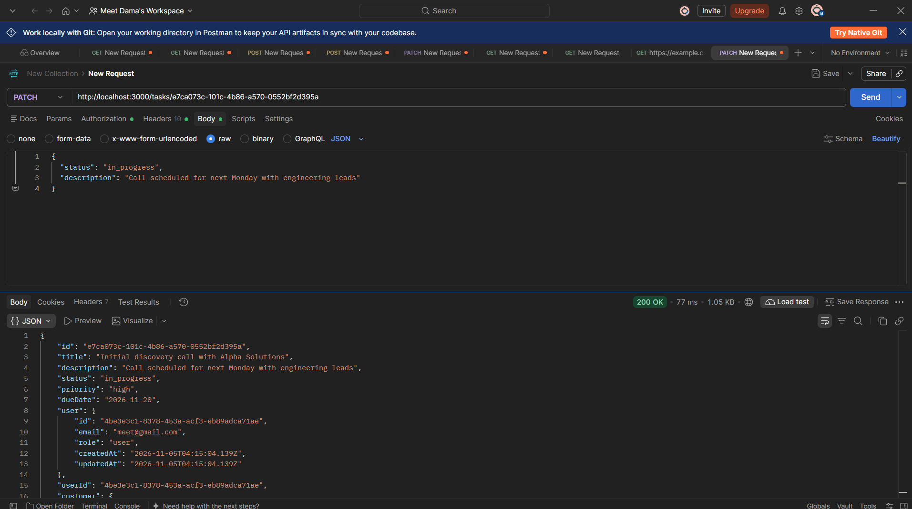 |
| **11. Task Deletion (DELETE)** | 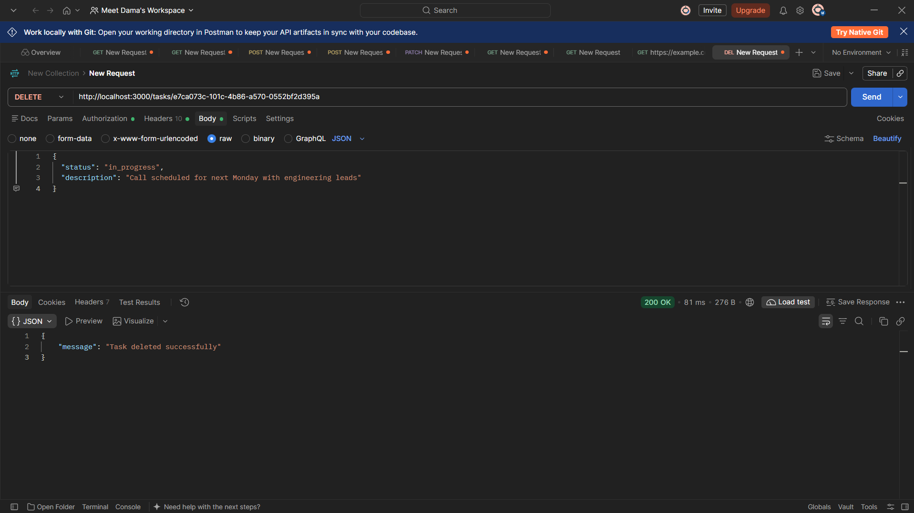 |
| **12. Unit Tests Passed (Jest)** | 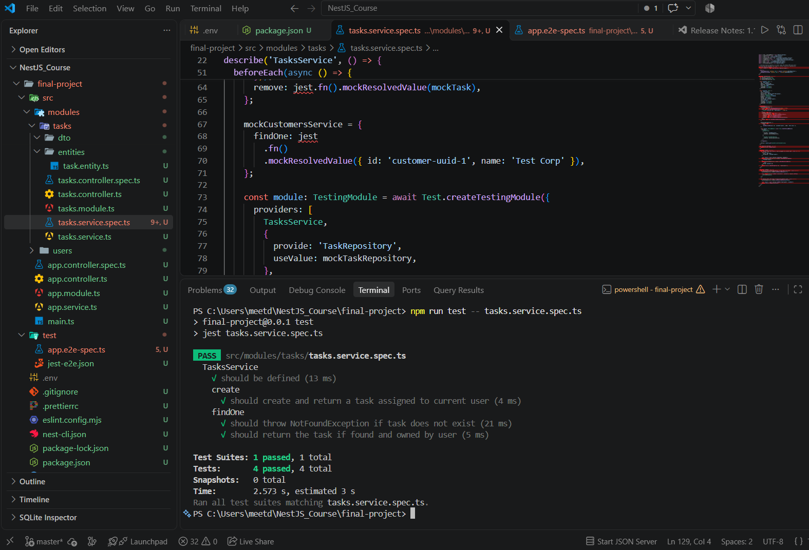 |
| **13. Swagger API Docs** | 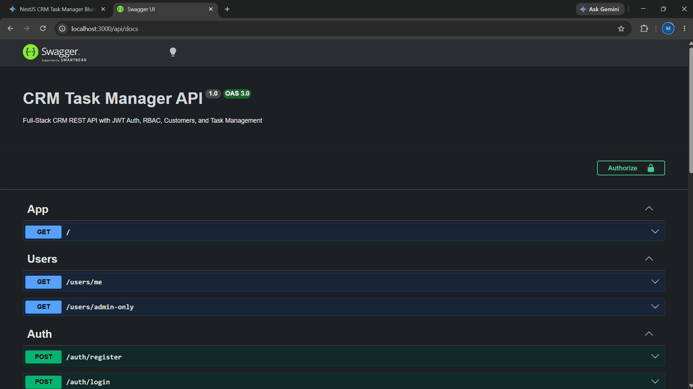 |
| **14. Docker Multi-Container** | 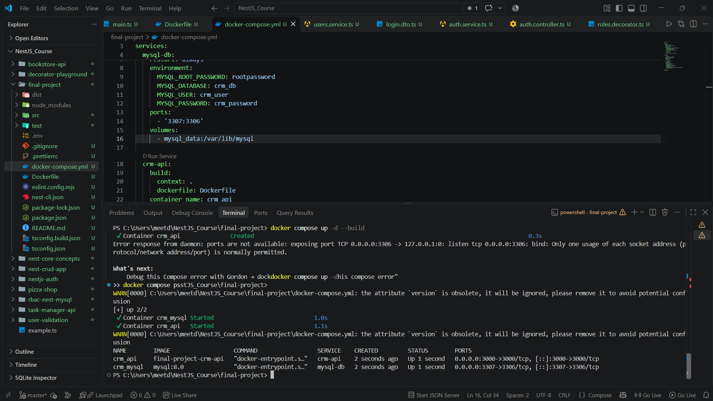 |
| **15. E2E Tests Passed** | 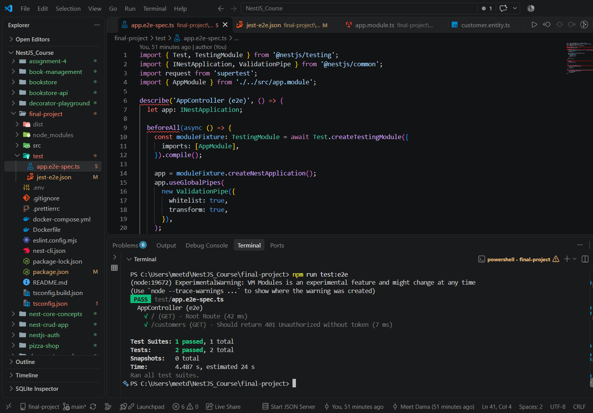 |